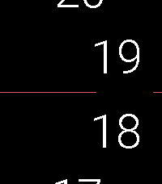
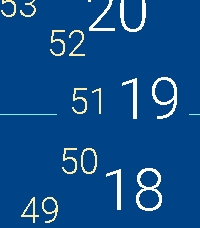
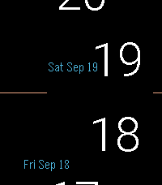
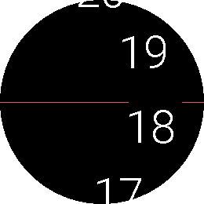
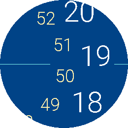
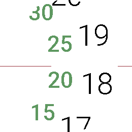

# Fix

*The time rolls past. The mark stays put.*

     

A Pebble watchface (v2.1.0).

Fix turns the watch into a set of rolling drums. The numbers travel along a
wide arc and a single horizontal line points at the one that counts right
now — the way a tuning dial or an odometer reads. Nothing spins around a
centre, nothing needs decoding: whatever sits on the line is the time.

The hours ride the outer arc. Depending on the mode you pick, an inner arc
carries the minutes, the seconds, the weekday, the month or the day — and
the dates roll too, so yesterday and tomorrow stay in view above and below
today.

**Exact minutes** is new. By default the minute drum is marked in steps of
five, the way a clock face is. Switch exact minutes on and every single
minute gets its own position on the drum, so the line points at 37 rather
than somewhere between 35 and 40. The drum keeps the same spacing and the
same type size — it simply steps once a minute instead of once every five.

Every element has its own colour: background, hours, minutes, seconds, date
and the pointer line. The display can be flipped left to right, and the
drums can be told to roll the other way. Minutes, seconds and dates each
have a bold option.

Built for the whole family, from the original Pebble to Pebble Time 2 and
Pebble Round 2. On the two large displays the numerals are drawn from a
dedicated typeface at a size the system fonts cannot reach, so they fill the
screen the way they do on the smaller models.

## Settings

- **Background / Hour / Minute / Seconds / Date / Line colour** — one for
  each element of the face.
- **Use 24-Hour Format** — 0 to 23 instead of 1 to 12.
- **Flip Display** — moves the whole dial to the other side of the screen.
- **Toggle Auto-Rotation** — reverses the direction the drums roll in.
- **Exact Minutes** — every minute on the drum instead of five-minute steps.
  Works in every mode that shows minutes.
- **Bold Minutes / Bold Seconds / Bold Date** — heavier type for those rows.
- **Static Date (no rotation)** — keeps today's date on the line instead of
  letting the date drum turn through the day.
- **Select Time Mode** — what the inner arcs carry:
  - Hours only
  - Hours and Minutes
  - Hours, Minutes and Seconds
  - Hours, Weekday, Month and Day
  - Hours, Weekday and Day
  - Hours, Month and Day
  - Hours, Minutes and Day
  - Hours and big Minutes

  Displaying seconds keeps the watch redrawing once a second and will drain
  the battery faster.

## Platforms

- Pebble Time 2 (`emery`)
- Pebble Round 2 (`gabbro`)
- Pebble Time Round (`chalk`)
- Pebble Time (`basalt`)
- Pebble 2 (`diorite`)
- Pebble 2 Duo (`flint`)
- Pebble / Pebble Steel (`aplite`)

## Building

With the [Pebble SDK](https://developer.repebble.com/sdk/):

```bash
pebble build
pebble install --emulator emery
```

The repository can also be imported into CloudPebble as is.

## Release notes

### 2.1.0

- **Exact minutes.** A new setting puts every single minute on the minute
  drum instead of the five-minute grid. It applies to all modes that show
  minutes, including big minutes.
- **Larger numerals on Pebble Time 2 and Pebble Round 2.** Those two
  displays have far more pixels than the rest of the family, and the largest
  light system font stops at 42 px — so the hours, minutes, seconds and the
  day of month are now drawn from a bundled typeface, about 40 % taller than
  before. The pointer line was re-measured to end just short of the numbers
  instead of leaving a widening gap. All other models render exactly as
  before.
- **Wider drums on the two large displays.** The arc the numbers travel on
  is drawn at a much larger radius, tuned separately for each of the two
  screens. The rows stand almost straight instead of curling towards the
  left edge, they sit further apart, and the inner rings — minutes, seconds,
  date — are no longer squeezed into a small circle at the side.
- **Numbers now roll in from off screen.** A row used to appear from nowhere
  at the top of the display instead of sliding in. The drum carries a full
  turn of labels, so a number is only ever replaced on the far side, well
  outside the display.
- **The pointer line closes up on the number again.** On the two large
  displays the line stopped short and the segment on the far edge sat too
  far away, so the number floated in an oversized gap. Both were measured
  against the smaller models and brought back to the same fit.
- The two long date rows (weekday and month) keep the system font on the
  large displays: five date entries share one arc and two of them sit side
  by side at times, so a wider line would collide with its neighbour and
  with the hours.

## License

MIT License, see [LICENSE](LICENSE). The bundled fonts are not covered by it and
remain under their own licenses.
